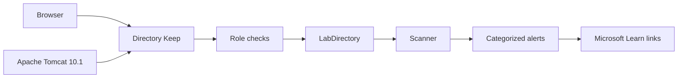

# Architecture

Directory Keep is a small Flask application with a lab directory behind it. The web tier never decides policy on its own. It asks the directory to act, and the directory asks the role model first.

In production the same shape holds, with `LabDirectory` replaced by a directory adapter and Tomcat in front of the Python process.

## Roles

| Session | Person | AD group the installer would use | Allowed changes |
| --- | --- | --- | --- |
| Auditor | Mina Rahman | Fabrikam-ADHK-Auditors | None |
| Helpdesk | James Okonkwo | Fabrikam-ADHK-Helpdesk | Unlock and reset standard users |
| Tier-0 | Olivia Grant | Fabrikam-ADHK-Tier0 | Privileged membership, disable, Protected Users, incident close |

The header role is a lab switch. On a member server those groups would be real, and the service account would not be a member of Tier-0.

Denied actions are written to the operator journal as **Denied**. Allowed actions append a Security event in the lab log: 4767 unlock, 4724 reset, 4725 disable, 4729 removal from Domain Admins, 4728 add to Protected Users.

## What a scan keeps

`build_alerts` reads current directory state plus open incidents. It does not promote every event.

| Kept as an alert | Left in the event log |
| --- | --- |
| 4740 lockouts that are still locked | 4624 successful sign-ins |
| 4728 that put the intern in Domain Admins, until he is removed | 4768 ticket requests |
| 1102 and 4719, until Tier-0 closes the incident | Events whose condition has already been fixed |
| 1925 while the Singapore link is failed | |
| Stale users, Guest, Administrator, krbtgt age, legacy password policy | |

Publishing a scan stores that list. Changing an account updates the directory immediately and raises a banner until someone publishes again. That is why Priya can be unlocked on her page while her lockout alert is still in the morning queue.

Health starts at 100. A critical finding costs 8, high costs 4, medium costs 2, and low costs 1. The fresh lab lands on 40, which is the **Action required** band. **Watch** starts at 60. **Steady** starts at 80.

## The lab domain

| Fact | Value |
| --- | --- |
| DNS name | fabrikam.corp |
| NetBIOS | FABRIKAM |
| Functional level | Windows Server 2016 |
| Domain controllers | Windows Server 2022 |
| Sites | London-HQ, Manchester, Singapore |
| PDC emulator | FAB-DC01 |
| Infrastructure master | FAB-DC02 |
| Failing link | FAB-DC02 → FAB-DC04, event 1925 |

Password policy in the lab is the legacy one: length 8, complexity on, 90-day maximum, lockout 5 attempts, 30 minutes. No fine-grained password settings objects. The reset utility is stricter than that policy on purpose.

## State

`instance/lab_state.json` holds the directory, the published queue, the scan journal, and the operator journal. **Reset lab data** replaces it with the morning snapshot. Passwords are not a field in that file.

## Code map

| Module | Responsibility |
| --- | --- |
| `ad_housekeeping/directory.py` | Seed data and the only place that mutates accounts |
| `ad_housekeeping/policy.py` | Passphrase checks and who may touch which account |
| `ad_housekeeping/scanner.py` | Categories, score, and drift |
| `ad_housekeeping/guidance.py` | Recommendation text and Learn URLs |
| `ad_housekeeping/web.py` | Pages, staging the Tomcat webapp |
| `installer/` | Linux stage script, Windows install script, Tomcat context |
